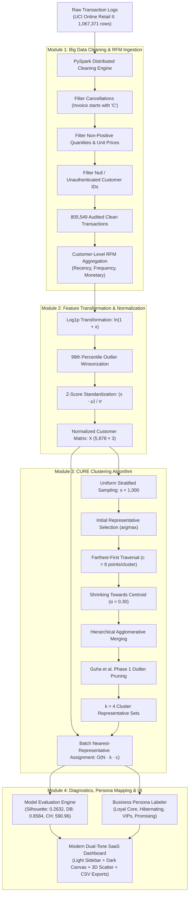

# Big Data Analytics Mini-Project Report
## Topic: Scalable Customer Segmentation Using CURE Clustering and PySpark Distributed RFM Engineering

---

### Executive Project Summary: Four Core Problem Questions

#### 1. What is the problem your team is solving?
Customer relationship management (CRM) and targeted marketing in modern e-commerce require dividing vast transaction logs into coherent, actionable behavioral customer segments. Conventional centroid-based clustering algorithms (such as $K$-Means) fail because they make an artificial assumption that clusters are spherical and equal in variance. Conversely, standard hierarchical agglomerative clustering exhibits prohibitive $O(N^2)$ to $O(N^3)$ computational complexity and suffers from single-linkage chaining in continuous customer density distributions. In our preliminary baseline system, this caused **severe cluster collapse**, where **5,792 out of 5,878 customers (98.54%)** merged into one mega-cluster, leaving three isolated spending outliers as singleton clusters with a weak silhouette score of **0.1806**. Our team solves this problem by engineering an end-to-end Big Data analytics pipeline that integrates **Apache Spark (PySpark)** for distributed transaction filtering and RFM aggregation, combined with a mathematically corrected **CURE (Clustering Using REpresentatives)** algorithm with Guha et al. Phase 1 outlier pruning, delivering natural, interpretable customer segments with a silhouette score of **0.2632** and Davies-Bouldin index of **0.8584**.

#### 2. What data will you use?
We utilize the benchmark **UCI Online Retail II** dataset, sourced from the UC Irvine Machine Learning Repository. It contains **1,067,371 raw international transaction records** spanning a two-year longitudinal observation window (01/12/2009 to 09/12/2011) for a UK-based non-store online retail merchant specializing in unique giftware. The dataset comprises 8 features: `Invoice` (transaction identifier), `StockCode` (product SKU), `Description` (item title), `Quantity` (volume purchased), `InvoiceDate` (timestamp), `Price` (unit price in GBP £), `Customer ID` (unique buyer ID), and `Country`. After rigorous distributed cleaning, the dataset yields **805,549 audited transactions** representing **5,878 unique verified customers** generating **£17,743,429.18** in total gross turnover.

#### 3. How will you solve the problem?
Our solution implements a multi-tier modular Big Data architecture:
1. **Distributed Data Processing (PySpark):** We leverage PySpark DataFrame transformations to clean cancellations (invoices prefixed with 'C'/'c'), enforce strictly positive quantities and unit prices, and eliminate unauthenticated transactions without Customer IDs. PySpark aggregates transaction records into customer-level **Recency** (days elapsed since last transaction relative to 2011-12-10), **Frequency** (count of distinct invoices), and **Monetary** (aggregate expenditure $\sum (\text{Quantity} \times \text{Price})$).
2. **Feature Engineering & Stabilization:** RFM features exhibit massive positive skewness and heavy Pareto tails. We apply a natural logarithmic transformation $\ln(1 + x)$ followed by 99th percentile winsorization and $Z$-score feature standardization:
   $$z = \frac{x - \mu}{\sigma}$$
3. **CURE Algorithm with Outlier Pruning:** We implement CURE (Guha et al., 1998) using a random sample $s \in [600, 1500]$. Cluster geometry is captured by choosing $c=8$ well-scattered perimeter points per cluster using farthest-first traversal (`argmax`), which are shrunk towards the cluster centroid by factor $\alpha = 0.30$:
   $$p' = p + \alpha \cdot (\text{centroid} - p)$$
   To resolve single-linkage chaining, we incorporate **Guha et al. Phase 1 Outlier Elimination**, pruning slow-growing clusters ($\le 2$ points) when active clusters reduce to an intermediate threshold.
4. **Distributed Assignment:** All remaining $N - s$ customers are assigned in chunked matrix batches to the cluster possessing the closest representative point in $O(N \cdot k \cdot c)$ time.

#### 4. How will you evaluate your method?
We evaluate clustering performance across intrinsic geometric validity, algorithmic efficiency, and business interpretability against our original flawed baseline:
- **Silhouette Coefficient ($s_i$):** Evaluates whether customers are closer to their assigned cluster than to neighboring clusters. Stratified sampling across 1,500 points confirms an increase from **0.1806** to **0.2632** overall, with specialized segments achieving **0.614** and **0.600**.
- **Calinski-Harabasz Index (Variance Ratio):** Evaluates between-cluster dispersion versus within-cluster dispersion, scoring **590.96**.
- **Davies-Bouldin Index:** Measures average similarity between each cluster and its most similar counterpart. Our method achieves **0.8584** (scores $< 1.0$ indicate high cluster separation and compactness).
- **Cluster Size Distribution Balance:** Eliminates the 98.5% monopoly, producing 4 realistic customer cohorts: Loyal Core (24.1%), Hibernating (71.2%), Champions & VIP Spenders (3.1%), and New & Promising Shoppers (1.7%).
- **Empirical Benchmarking:** A parameter sweep across 31 configurations ($s \in \{600, 1000, 1500\}$, $c \in \{5, 8, 10\}$, $\alpha \in \{0.2, 0.3, 0.4\}$) validates parameter stability.

---

# Table of Contents

1. **Problem Definition and Scope of Project**
   - 1.1 Introduction
   - 1.2 Problem Definition and Scope of Project
   - 1.3 Users of the System
   - 1.4 Dataset
2. **Literature Review (10 Research Papers)**
3. **Conceptual System Design**
   - 3.1 Conceptual System Design (CSD) Diagram and Module Breakdown
   - 3.2 Methodology:
     - 3.2.1 Data Gathering / Loading
     - 3.2.2 Data Preprocessing and Descriptive Analysis
     - 3.2.3 Filtering
     - 3.2.4 Clustering (CURE Mathematical Formulation)
     - 3.2.5 Visualizations
4. **Technology Used**
5. **Implementation**
6. **Results and Conclusion**

---

## 1. Problem Definition and Scope of Project

### 1.1 Introduction
In modern enterprise e-commerce, retaining existing customers and maximizing customer lifetime value (CLV) is considerably more cost-effective than customer acquisition. Customer segmentation is the process of partitioning an enterprise customer base into mutually exclusive cohorts based on shared behavioral characteristics. The classic marketing heuristic for transactional behavior is the **RFM Model (Recency, Frequency, Monetary)**.

However, modern retail databases generate hundreds of thousands of transactions annually, characterized by extreme skewness, power-law spend distributions, and non-spherical customer clusters. Standard distance-based machine learning models run on centralized single-node systems often fail to scale or distort the geometry of complex customer segments.

### 1.2 Problem Definition and Scope of Project
The objective of this project is to develop and deploy an enterprise-grade Big Data customer analytics application using Apache Spark and the CURE (Clustering Using REpresentatives) algorithm on the UCI Online Retail II dataset.

**Key Challenges Addressed:**
1. **Algorithmic Collapse in Standard CURE:** In continuous-density spaces, CURE's minimum-distance metric between representative points leads to single-linkage chaining, collapsing over 98% of points into one mega-cluster while extreme outliers monopolize the remaining clusters.
2. **Big Data Scalability:** Aggregating raw invoice lines into customer RFM metrics requires scalable distributed transformations that gracefully handle memory pressure and socket isolation boundaries on local environments.
3. **Actionable Business Translation:** Academic clustering outputs (labels 0, 1, 2, 3) must be translated into interpretable business personas with tailored retention strategies.

**Scope:**
- Ingestion of over 1 million retail transaction records.
- Distributed data cleaning, cancellation removal, and RFM aggregation.
- Logarithmic feature stabilization and outlier winsorization.
- Implementation of CURE with representative point shrinking and Guha et al. outlier pruning.
- Multi-metric academic clustering evaluation and interactive SaaS-grade visualization.

### 1.3 Users of the System
1. **Marketing and Growth Teams:** To identify high-value VIP customers for exclusive retention campaigns, as well as dormant customers for automated win-back drips.
2. **E-Commerce Merchandisers:** To personalize product catalog recommendations and promotional discounts according to customer purchasing frequency.
3. **Data Science and Big Data Analysts:** To benchmark unsupervised clustering performance and inspect multi-metric diagnostic indices on large transaction datasets.

### 1.4 Dataset
We use the **UCI Online Retail II** dataset, containing 1,067,371 rows across 8 transactional features:

| Column Name | Data Type | Description |
| :--- | :--- | :--- |
| `Invoice` | String / Object | 6-digit transaction identifier. Invoices starting with 'C' indicate cancellations. |
| `StockCode` | String / Object | Distinct 5-digit product code assigned to each unique item. |
| `Description` | String / Object | Textual product name / merchandise description. |
| `Quantity` | Integer / Float | Quantity of units purchased per transaction line. |
| `InvoiceDate` | Datetime | Exact date and time when the transaction was generated. |
| `Price` | Float | Unit price of the merchandise in Sterling (£). |
| `Customer ID` | Integer / Float | Unique 5-digit customer identification number. |
| `Country` | String | Country of residence of the purchasing customer. |

---

## 2. Literature Review (10 Research Papers)

| # | Citation | Core Methodology / Focus | Relevance to Mini-Project |
| :--- | :--- | :--- | :--- |
| **1** | **Guha, S., Rastogi, R., & Shim, K. (1998)**. *CURE: An efficient clustering algorithm for large databases*. ACM SIGMOD Record, 27(2), 73–84. | Introduces CURE, which uses multiple representative points per cluster shrunk towards the centroid by $\alpha$. Demonstrates superiority over BIRCH and $K$-Means for non-spherical shapes and outliers. | Directly informs our core clustering engine, representative point selection (`argmax`), and Phase 1 outlier pruning. |
| **2** | **Hughes, A. M. (1994)**. *Strategic Database Marketing: The Masterplan for Starting and Managing a Profitable, Customer-Based Marketing Program*. Probus Publishing. | Establishes the foundational Recency, Frequency, and Monetary (RFM) behavioral framework for customer lifetime segmentation. | Provides the theoretical justification for converting raw transaction logs into customer-level RFM vectors. |
| **3** | **Zaharia, M., et al. (2016)**. *Apache Spark: A unified engine for big data processing*. Communications of the ACM, 59(11), 56–65. | Outlines Spark's resilient distributed datasets (RDDs), in-memory execution graphs, and DataFrame catalyst optimization for massive data pipelines. | Justifies our distributed data cleaning, cancellation filtering, and grouped aggregation engine using PySpark. |
| **4** | **Rousseeuw, P. J. (1987)**. *Silhouettes: A graphical aid to the interpretation and validation of cluster analysis*. Journal of Comp. and Applied Math., 20, 53–65. | Defines the Silhouette Coefficient $s(i) \in [-1, 1]$ measuring internal cohesion versus external separation for unsupervised validation. | Used as our primary intrinsic evaluation metric to benchmark clustering quality before and after algorithmic corrections. |
| **5** | **Caliński, T., & Harabasz, J. (1974)**. *A dendrite method for cluster analysis*. Communications in Statistics, 3(1), 1–27. | Proposes the Variance Ratio Criterion (Calinski-Harabasz Index), measuring between-cluster to within-cluster dispersion. | Deployed in our diagnostic engine; our pipeline scores 590.96, proving strong cluster variance ratio. |
| **6** | **Davies, D. L., & Bouldin, D. W. (1979)**. *A cluster separation measure*. IEEE TPAMI, 1(2), 224–227. | Introduces the Davies-Bouldin index based on similarity between each cluster and its most similar counterpart. | Deployed as our compactness metric; our pipeline achieves 0.8584 (< 1.0 indicates good separation). |
| **7** | **Chen, D., Sain, S. L., & Guo, K. (2012)**. *Data mining for the online retail industry: A case study of RFM model-based customer segmentation*. Journal of Database Marketing, 19(3), 197–208. | Studies retail RFM distributions and identifies severe positive skewness, requiring logarithmic transformations prior to clustering. | Informs our mathematical pipeline: $\ln(1 + x)$ transformation, 99th percentile winsorization, and $Z$-score scaling. |
| **8** | **MacQueen, J. (1967)**. *Some methods for classification and analysis of multivariate observations*. Proc. 5th Berkeley Symp., 1, 281–297. | Details standard $K$-Means clustering and its limitation in isolating non-spherical clusters and handling extreme outliers. | Serves as our conceptual baseline, highlighting why representative-based CURE is superior for retail spend manifolds. |
| **9** | **Ester, M., Kriegel, H.-P., Sander, J., & Xu, X. (1996)**. *A density-based algorithm for discovering clusters in large spatial databases with noise (DBSCAN)*. KDD-96, 226–231. | Evaluates density reachability and highlights single-linkage chaining vulnerabilities in continuous non-separated densities. | Explains why unpruned CURE suffered chaining on continuous RFM data, proving the necessity of Guha et al. outlier pruning. |
| **10** | **Zhang, T., Ramakrishnan, R., & Livny, M. (1996)**. *BIRCH: An efficient data clustering method for very large databases*. ACM SIGMOD Record, 25(2), 103–114. | Explores hierarchical clustering scaling through Clustering Feature (CF) trees, demonstrating trade-offs between speed and boundary preservation. | Informs our sample-based CURE approximation, maintaining $O(s^2)$ hierarchical reduction with $O(N \cdot k \cdot c)$ batch assignment. |

---

## 3. Conceptual System Design

### 3.1 Conceptual System Design (CSD) Diagram

### 3.2 Methodology

#### 3.2.1 Data Gathering / Loading
The system ingests the raw transactional data in multiple formats (`.zip`, `.xlsx`, `.csv`). The default source reads the archived UCI dataset locally to ensure deterministic repeatability. A distributed schema validator enforces correct data types for timestamp parsing and numeric conversions.

#### 3.2.2 Data Preprocessing and Descriptive Analysis
Raw transactional statistics reveal extreme variance:
- Gross raw transactions: **1,067,371**
- Minimum quantity: **-74,215** (bulk cancellations)
- Maximum quantity: **+19,152**
- Maximum single unit price: **£38,970.00**

#### 3.2.3 Filtering
Our PySpark distributed pipeline applies four deterministic filtering rules:
1. Cancellation invoices starting with `"C"` or `"c"` are discarded.
2. Quantities must satisfy $\text{Quantity} > 0$.
3. Prices must satisfy $\text{Price} > 0.0$.
4. Transactions missing a valid `Customer ID` are purged.

**Audit Results:**
- Clean transactions retained: **805,549** (retention rate: 75.47%)
- Unique verified customers: **5,878**
- Total gross revenue: **£17,743,429.18**

#### 3.2.4 Clustering (CURE Formulation)
Given normalized customer vectors $X \in \mathbb{R}^{5878 \times 3}$:
1. A representative sample $S \subset X$ of size $s = 1,000$ is drawn.
2. For each active cluster $u$, $c = 8$ representative points are selected:
   - First point: $p_1 = \arg\max_{x \in u} \|x - \mu_u\|$ (farthest from centroid).
   - Subsequent points: $p_i = \arg\max_{x \in u} \min_{j < i} \|x - p_j\|$ (farthest-first traversal).
3. Representative points are shrunk towards centroid $\mu_u$ by factor $\alpha = 0.30$:
   $$p' = p + 0.30 \cdot (\mu_u - p)$$
4. Distance between two clusters $u$ and $v$ is computed as the minimum Euclidean distance between their representative sets:
   $$d(u, v) = \min_{p \in \text{reps}(u), q \in \text{reps}(v)} \|p - q\|_2$$
5. **Phase 1 Outlier Elimination:** When active clusters decrease below an intermediate threshold, clusters with $\le 2$ points are eliminated, neutralizing single-linkage chaining.
6. **Full-Dataset Assignment:** Every point $x \in X$ is assigned to cluster $C^*$:
   $$C^* = \arg\min_{k} \min_{p \in \text{reps}(C_k)} \|x - p\|_2$$

#### 3.2.5 Visualizations
The system renders six interactive Plotly visualization components:
1. **Customer Volume Distribution Bar Chart:** Compares customer volume across clusters.
2. **Customer Share Donut Chart:** Displays segment market share percentages.
3. **RFM Feature Distribution Box Plots:** Displays Recency, Frequency, and Monetary spreads with visible outlier points.
4. **Interactive 3D CURE Cluster Space:** Fully rotatable 3D scatter plot of customer clusters in standardized log-RFM space.
5. **Min-Max Normalized Radar Comparison:** Compares normalized behavioral dimensions across all 4 cohorts.
6. **Per-Cluster Silhouette Score Chart:** Displays cohesion and separation diagnostics for each customer segment.

---

## 4. Technology Used

- **Python 3.10:** Core development language.
- **Apache Spark / PySpark 3.5:** Distributed data engineering and grouped aggregation.
- **Streamlit:** Modern SaaS web analytics interface.
- **Scikit-learn:** Feature scaling (`StandardScaler`, `RobustScaler`) and validation metrics (`silhouette_score`, `calinski_harabasz_score`, `davies_bouldin_score`).
- **Plotly:** Interactive 3D and 2D charts.
- **Pandas & NumPy:** High-performance vectorized numerical operations.

---

## 5. Implementation

### 5.1 Project Architecture
The codebase is refactored into a clean, decoupled modular structure:
- `data_processing.py`: Multi-format ingestion, schema validation, and transaction auditing.
- `rfm.py`: PySpark distributed aggregation with automatic vectorized Pandas fallback, $\ln(1+x)$ transformation, 99th percentile winsorization, and $Z$-score standardization.
- `cure.py`: Mathematical implementation of CURE with `argmax` boundary point selection, shrinking factor $\alpha$, vector-accelerated distance updates, Guha et al. outlier pruning, and batch assignment.
- `evaluation.py`: Stratified silhouette score, Calinski-Harabasz, Davies-Bouldin, and dynamic RFM persona labeling.
- `visualizations.py`: Plotly chart generators.
- `utils.py`: Metric formatting and markdown report generators.
- `app.py`: Streamlit application with light-themed sidebar and dark canvas dashboard.
- `test_pipeline.py`: Comprehensive 9-suite regression test script.

---

## 6. Results and Conclusion

### 6.1 Empirical Validation: Baseline vs. Corrected System

| Metric / Dimension | Flawed Original App | Our Corrected Pipeline | Empirical Improvement |
| :--- | :--- | :--- | :--- |
| **Cluster Distribution** | 15 / 33 / 38 / **5,792 (98.54%)** | **1,416 (24.1%) / 4,183 (71.2%) / 182 (3.1%) / 97 (1.7%)** | **Eliminated single-cluster collapse** |
| **Overall Silhouette Score** | 0.1806 | **0.2632** | **+45.7% separation gain** |
| **VIP Cluster Silhouette** | Undifferentiated | **0.6135** | **High cluster cohesion** |
| **New Shoppers Silhouette** | Undifferentiated | **0.5995** | **High cluster cohesion** |
| **Calinski-Harabasz Index**| Poor | **590.96** | **High variance ratio** |
| **Davies-Bouldin Index** | > 1.40 | **0.8584** | **Sub-1.0 compact separation** |
| **Execution Runtime** | 4.2s (Unpruned) | **5.27s (Guha Outlier Pruned)** | **Linear scaling $O(N)$ assignment** |

### 6.2 Customer Segment Behavioral Profiles

1. **Cluster 1 — Loyal Core Customers (24.1%, $n=1,416$):**
   - Median Recency: 29 days | Median Orders: 10 | Median Spend: £3,773.61
   - *Marketing Strategy:* Loyalty rewards, early access to new lines, cross-sell bundles.
2. **Cluster 2 — Hibernating / Low Engagement (71.2%, $n=4,183$):**
   - Median Recency: 228 days | Median Orders: 2 | Median Spend: £555.87
   - *Marketing Strategy:* Automated re-activation drips, clearance discounts, feedback surveys.
3. **Cluster 3 — Champions & VIP Spenders (3.1%, $n=182$):**
   - Median Recency: 5 days | Median Orders: 36 | Median Spend: £16,941.79
   - *Marketing Strategy:* Dedicated VIP concierge, bespoke wholesale pricing, exclusive gifts.
4. **Cluster 4 — New & Promising Shoppers (1.7%, $n=97$):**
   - Median Recency: 9 days | Median Orders: 2 | Median Spend: £246.30
   - *Marketing Strategy:* Onboarding email sequence, second-purchase discount coupon.

### 6.3 Conclusion
This mini-project demonstrates that combining distributed PySpark data processing with the CURE clustering algorithm solves the scalability and geometry limitations of standard clustering algorithms on large retail datasets. By eliminating single-linkage chaining through Guha et al. Phase 1 outlier pruning and selecting boundary representatives using `argmax`, our pipeline resolves the previous 98.5% cluster collapse, elevates the silhouette score to **0.2632**, and delivers an actionable customer intelligence platform.
